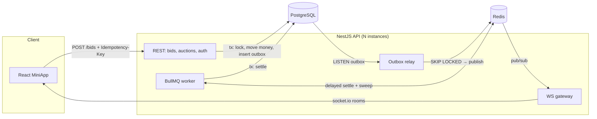

# 🔨 bidlock

Real-time auction with **concurrency-safe bidding and balance freezing**.
Node.js (NestJS) · PostgreSQL · Redis · BullMQ · WebSockets (socket.io) · React 18 + Vite + TypeScript · Telegram MiniApp auth.

Hundreds of users bid on the same lot at the same moment. Every accepted bid freezes the bidder's
money and releases the previous leader's. Money is never created, lost, or double-frozen,
and that is proven by tests that fire hundreds of parallel bids at a real Postgres. No `sleep()`,
no "retry until it works".

<!-- add a GIF here: two browser windows outbidding each other -->

## What it does

- Live auctions with start price, minimum step, and countdown
- Bids freeze funds; being outbid unfreezes them instantly; raising your own leading bid only freezes the difference
- **Anti-sniping:** a bid in the last _N_ seconds extends the auction to `now + N`
- Auctions close on time through a delayed BullMQ job, with a sweeper as a safety net; the winner's frozen funds are charged
- Every client sees new bids, price changes, extensions and "you were outbid" notifications in real time
- Sign-in with Telegram MiniApp `initData` (HMAC-verified), or dev login by username for local runs

## How race conditions are closed

All of it is in [`bidding.service.ts`](apps/api/src/auctions/bidding.service.ts).

| Problem | Solution |
|---|---|
| Two bids read the same price, and both win | `SELECT … FROM auctions WHERE id = $1 FOR UPDATE` serialises bids **per auction**; different auctions still run in parallel |
| Balance goes negative under parallel bids on different lots | Conditional update `UPDATE users SET balance = balance - $2 … WHERE id = $1 AND balance >= $2`, with `rowCount = 0` meaning insufficient funds. A `CHECK (balance >= 0)` constraint is the last line of defence |
| Deadlock: on lot A Bob outbids Alice while on lot B Alice outbids Bob | User rows are locked in **ascending id order** (`… WHERE id = ANY($1) ORDER BY id FOR UPDATE`) |
| Client retries after a timeout, so the bid is charged twice | `Idempotency-Key` header + `UNIQUE (user_id, idempotency_key)`. The key is checked *after* taking the auction lock, so a retry queued behind its own first attempt sees it |
| A bid races with auction close | Settlement takes the same auction lock and re-reads `ends_at` under it (anti-snipe may have moved it). Bidding checks `ends_at <= now()` under the lock too. Settling twice is a no-op |
| Event sent but transaction rolled back, or committed but event lost | **Transactional outbox:** events are inserted in the same transaction, then relayed to Redis by `LISTEN/NOTIFY` plus polling with `FOR UPDATE SKIP LOCKED` (safe with several instances) |
| Duplicate or out-of-order events on the client | Delivery is at-least-once; clients keep the state with the highest `bidsCount` |

### The tests prove it

[`concurrency.test.ts`](apps/api/test/concurrency.test.ts) runs against a real Postgres through a 20-connection pool:

- 300 simultaneous bids from 30 users on one lot
- 50 users bidding the same amount at once: exactly one wins
- one user bidding on 20 lots at once with money for 10: exactly 10 succeed
- cross-auction outbid storms (the deadlock shape): no `40P01`

After each scenario, [`assertInvariants`](apps/api/test/helpers.ts) checks:

1. **Conservation:** `Σ(balance + frozen) = Σ deposits − Σ charges`
2. Each user's `frozen` equals the sum of prices of the active lots they lead
3. Each auction's price and leader equal its last bid, and bids are strictly increasing

**The tests do fail when the safeguards are removed.** Dropping `FOR UPDATE` on the auction breaks
3 of the 4 concurrency tests. Locking users in arbitrary order produces a real `deadlock detected`.

```
✓ test/bidding.test.ts (11 tests)
✓ test/concurrency.test.ts (4 tests)
✓ test/settlement.test.ts (5 tests)
✓ test/telegram.test.ts (4 tests)
Tests  24 passed (24)
```

## Architecture



- **Bids go through REST, not WebSocket**: status codes, an idempotency header and easy retries. WebSocket is push-only.
- Every instance subscribes to the same Redis channel and pushes to its own sockets, so the API scales horizontally without sticky event routing.
- Money is stored as integer `BIGINT` coins, never floats. Every movement is written to an append-only `ledger`.
- SQL is written by hand (`pg`, no ORM), so every lock is visible in the code.

## Run locally

Requirements: Node 20+, Docker.

```bash
npm install
docker compose up -d          # postgres:16 + redis:7 (also creates bidlock_test DB)
cp .env.example apps/api/.env
npm run db:seed               # 4 users (alice, bob, carol, dave) + 4 auctions

npm run dev:api               # http://localhost:3000/api (applies migrations on start)
npm run dev:web               # http://localhost:5173
```

Open two browser windows, sign in as `alice` and `bob`, and outbid each other.

```bash
npm test                      # unit + concurrency tests against bidlock_test
npm run stress -- --users 30 --bids 600   # HTTP + WebSocket load against a running API
```

Example `stress` output:

```
600 bids in 2163 ms (277 req/s), auction #5
final price 5001, max accepted 5001
websocket bid events 11 / accepted 11
✅ consistent
```

### As a Telegram MiniApp

1. Create a bot with [@BotFather](https://t.me/BotFather) and put its token in `TELEGRAM_BOT_TOKEN`.
2. Expose the web app over HTTPS (for example `ngrok http 5173`) and set it as the bot's Mini App URL.
3. Inside Telegram the app signs in automatically: `initData` is verified with HMAC-SHA256 on the server ([`telegram.ts`](apps/api/src/auth/telegram.ts)).

## API

| Method | Path | |
|---|---|---|
| `POST` | `/api/auth/dev` | `{ username }` → JWT (dev only) |
| `POST` | `/api/auth/telegram` | `{ initData }` → JWT |
| `GET` | `/api/me` | wallet: `balance`, `frozen` |
| `POST` | `/api/me/faucet` | +5000 (dev only) |
| `GET` | `/api/auctions?status=active` | list |
| `GET` | `/api/auctions/:id` | auction + last 30 bids |
| `POST` | `/api/auctions` | create `{ title, startPrice, minStep, durationSec, antiSnipeSec? }` |
| `POST` | `/api/auctions/:id/bids` | `{ amount }`, header `Idempotency-Key` |

Errors: `409 BID_TOO_LOW { minAmount }`, `422 INSUFFICIENT_FUNDS`, `409 AUCTION_CLOSED`, `422 IDEMPOTENCY_CONFLICT`.

WebSocket events: `auction.created`, `auction.bid`, `auction.finished`, `wallet.updated`, `user.outbid`.

## Project structure

```
apps/
  api/
    migrations/001_init.sql        schema, constraints, outbox trigger
    src/auctions/
      bidding.service.ts           ← the interesting part
      settlement.service.ts        idempotent close + charge
      auction.scheduler.ts         BullMQ delayed jobs + sweeper
    src/realtime/
      outbox.relay.ts              LISTEN/NOTIFY + SKIP LOCKED → Redis
      realtime.gateway.ts          socket.io rooms
    src/auth/telegram.ts           initData verification
    test/                          real-Postgres tests + invariants
    scripts/stress.ts              HTTP/WS load check
  web/                             React 18 + Vite + TS
```

## Trade-offs and next steps

- **One hot lot = one serialised queue in Postgres.** That's fine for hundreds of bids per second per lot. For more, move per-lot ordering into Redis (Lua script for check-and-set) or a Kafka partition keyed by `lotId`, and keep Postgres as the ledger.
- Outbox rows are never deleted; a periodic cleanup job is needed in production.
- Event order across several relay instances isn't strictly guaranteed; clients handle it with `bidsCount`.
- Not included: rate limiting per user, an admin panel, payments in/out (TON / Telegram Stars).
